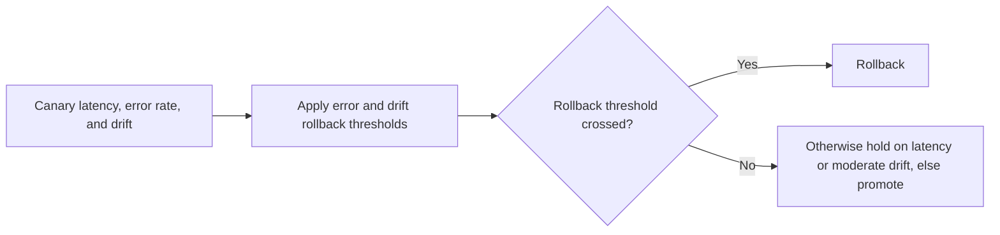

# Model Serving Canary Analyzer

Evaluates model-serving canaries using latency, error rate, and prediction drift before routing more traffic.

Focus: model serving, canary release, SLOs, MLOps.

Portfolio framing: Apple-scale client-style AI platform project using synthetic data only.

## Run

```bash
python3 canary_analyzer.py sample_canaries.csv
```

## Verify

```bash
python3 -m unittest discover . -v
```

## Local verification

Run `make verify` with Make and Python 3 installed. The target runs the documented sample through the project CLI. It also runs the existing Python unit tests.

## Business problem

A serving rollout needs a documented decision before expanding traffic when error rate, tail latency, and prediction drift disagree.

## Project walkthrough



[Architecture and data flow](docs/ARCHITECTURE.md) · [Business problem, demo, and verification](docs/CASE_STUDY.md)

Run `python3 canary_analyzer.py sample_canaries.csv --json` for reviewable
decision reasons alongside model and traffic percentage.
