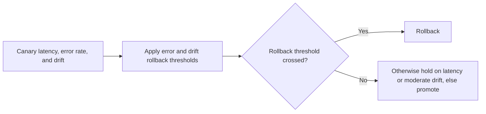

# Model Serving Canary Analyzer

A serving rollout needs a documented decision before expanding traffic when error rate, tail latency, and prediction drift disagree.

[Skills and verification](docs/ENGINEERING_NOTES.md)

## What I built

I built a canary decision CLI that checks severe drift and error thresholds first, then evaluates moderate drift and p95 latency before promoting. JSON output shows the matched reasons.

## How it works



[Architecture](docs/ARCHITECTURE.md) · [Decision rules and source](docs/RULES.md)

## Tools used

| Tool | Role in this repository |
| --- | --- |
| Python | [canary_analyzer.py](canary_analyzer.py) implements the CLI and decision rules. Uses `argparse` to parse command-line options, `csv` to read tabular exports, `json` to read or write structured records. |
| Make | Runs the documented example and the local `unittest` suite. |
| Python replay runner | Compares actual stdout with the checked-in baseline fixtures. |
| Ruff and Bandit | Developer lint and static security checks through `make check`. |

## Run the project

Use Python 3.10+ and Make. From the repository root:

```sh
python3 canary_analyzer.py sample_canaries.csv
```

The fixture promotes ranker-v18, rolls back vision-v7, and holds fraud-v12. [Full expected output](examples/Demo%201.stdout.txt)

### Additional replay cases

- **Decision reasons** · `python3 canary_analyzer.py sample_canaries.csv --json` · [Expected output](examples/Decision%20reasons.stdout.txt)

## Verify the project

```sh
make verify
make replay
```

`make replay` checks the recorded cases and exits nonzero if the output changes.
See the [developer guide](docs/DEVELOPMENT.md) for the pinned lint and security tools.

Invalid or non-finite numeric telemetry produces a hold with a reason code.

## Operating limits

The project evaluates supplied canary summaries. It does not gather metrics or shift traffic. Apply thresholds only after checking sample volume and validation policy.

[Case study](docs/CASE_STUDY.md) · [Operator runbook](docs/RUNBOOK.md) · [Verification report](reports/verification.md)
