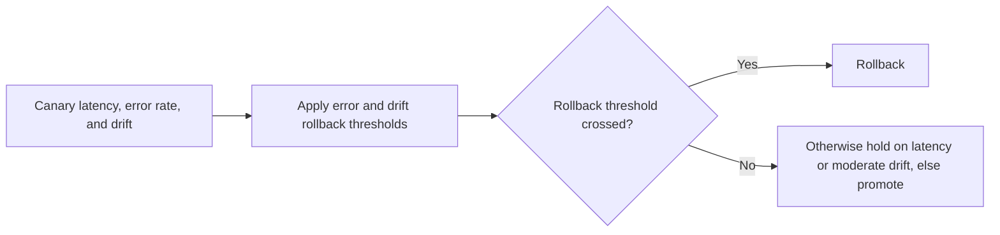

# Model Serving Canary Analyzer

Evaluates model-serving canaries using latency, error rate, and prediction drift before routing more traffic.

Focus: model serving, canary release, SLOs, MLOps.

Portfolio framing: Apple-scale client-style AI platform project using synthetic data only.

## Run

```bash
python3 canary_analyzer.py sample_canaries.csv
```

## Verify

```bash
python3 -m unittest discover . -v
```

## Local verification

Run `make verify` with Make and Python 3 installed. The target runs the documented sample through the project CLI. It also runs the existing Python unit tests.

## Business problem

A serving rollout needs a documented decision before expanding traffic when error rate, tail latency, and prediction drift disagree.

## Project walkthrough



[Architecture and data flow](docs/ARCHITECTURE.md) · [Business problem, demo, and verification](docs/CASE_STUDY.md)

Run `python3 canary_analyzer.py sample_canaries.csv --json` for reviewable
decision reasons alongside model and traffic percentage.

## Run the project

### Local setup

Run `make verify` with Python 3 and Make installed.

### CLI usage

```sh
python3 canary_analyzer.py sample_canaries.csv
```

### Replay usage

Run `make replay` to replay the checked-in inputs. The runner compares stdout with the baseline, reports differences, and exits nonzero on regression.

[Replay cases](examples/replay-manifest.json) · [Generated report](reports/replay.md) · [Rule implementation](docs/RULES.md)

### Run tests

[Verification report](reports/verification.md) · [Business problem, sample behavior, and limitations](docs/CASE_STUDY.md)

### Container demo

The [Dockerfile](infra/Dockerfile) packages the CLI and its synthetic input.
Emits the three sample canary decisions with reason codes.

```sh
docker build -f infra/Dockerfile -t model-serving-canary-analyzer:local .
docker run --rm --network none model-serving-canary-analyzer:local
```

Local Python verification passed. The container build and execution were
outside this environment's verification.

### Limitations

The verification report covers the bundled local examples. See the [case study](docs/CASE_STUDY.md) for project-specific assumptions and operating limits.
