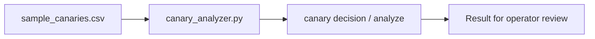

# Model Serving Canary Analyzer architecture

Evaluates model-serving canaries using latency, error rate, and prediction drift before routing more traffic.

## Operational boundaries

The documented run evaluates the bundled sample locally. Results depend on the quality and scope of the input. The demo makes no live infrastructure changes.
